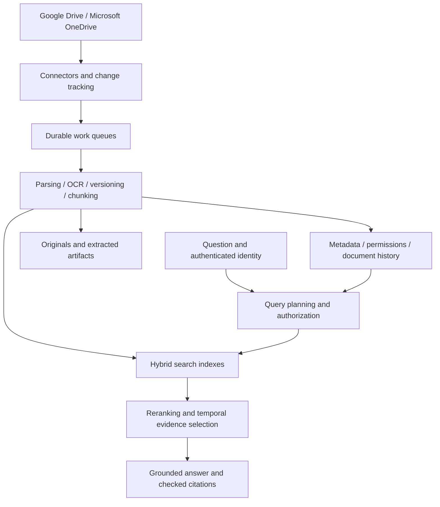

# RAG Platform

### Connected company knowledge. Current answers. Traceable evidence.

An extensible, self-hosted knowledge platform designed to turn company files into permission-aware answers with precise citations. Start with Google Drive and Microsoft OneDrive on a single machine, with a planned path to distributed processing and optional knowledge graph retrieval.

> **Project status:** specification and development roadmap. This repository currently contains the product and engineering blueprints. The application, connectors, deployment manifests, and performance claims have not yet been implemented or validated. There is no runnable release today.

## Why this project exists

Company knowledge changes. A useful answer must find relevant evidence, determine whether it still applies, respect who can see it, and make its sources easy to inspect.

For example, asking “What is the leave policy?” should return the approved policy effective for the employee’s location and employment type—not simply the file uploaded most recently. When an accessible older policy differs, the answer can offer a short historical note and a comparison.

## Product direction

- **Connected knowledge:** incremental ingestion from Google Drive and OneDrive, with a connector interface for future sources.
- **Current and historical answers:** effective dates, authoritative sources, supersession, policy scope, and conflict reporting.
- **Evidence you can inspect:** document titles, section or page references, previews, and links to original sources.
- **Access-aware retrieval:** tenant isolation and source permissions across search, answers, previews, caches, and optional graph traversal.
- **Hybrid retrieval:** keyword and vector search, structure-aware chunks, reranking, and selective multi-step query planning.
- **Structured data support:** CSV and spreadsheet discovery with controlled analytical execution for calculations.
- **Choice of models:** configurable embedding, reranking, generation, and OCR providers, with local-model extension points.
- **Operational visibility:** ingestion progress, failures, quality evaluations, costs, capacity, and recovery tools.
- **Optional knowledge graphs:** disabled by default; evaluated recommendations and administrator-controlled activation.
- **Scalable deployment:** single-machine operation first; distributed workers and Kubernetes deployment in later milestones.

These are planned capabilities. Track implementation in [the roadmap](planning/IMPLEMENTATION_PLAN.md) and [project status](planning/PROGRESS.md).

## Planned experience

| Workspace | Purpose |
|---|---|
| Ask | Ask questions, inspect citations, compare historical policies, and provide feedback |
| Sources | Connect storage, choose indexing scope, and inspect synchronization status |
| Knowledge | Explore documents, versions, authority rules, and policy conflicts |
| Quality | Inspect evaluations, retrieval quality, latency, and answer feedback |
| Operations | Monitor jobs, costs, capacity, and upgrade recommendations |
| Settings | Manage identity, security, models, retrieval, retention, and deployment |

The web interface is intended to be accessible, responsive, and visually polished, with clear onboarding and useful error states.

## Architecture



The search index is a derived view. Durable metadata, source identities, processing versions, and artifacts support recovery and reindexing. Optional graphs supplement keyword and vector retrieval; they do not replace them.

## Deployment direction

**Single machine:** the first runnable release will use Docker Compose. Model APIs reduce local compute requirements; local models require additional resources.

**Local distributed testing:** a later `kind` or `k3d` profile will simulate multiple nodes on a Mac. This tests scheduling and recovery, not real cloud provisioning or production availability.

**Production distributed deployment:** later Kubernetes support will separate query and ingestion pools. Worker autoscaling requests capacity; a supported infrastructure autoscaler supplies machines within administrator-configured limits. Stateful services require separate capacity and recovery procedures.

No file-count or billion-document capacity guarantee is made. Capacity depends on chunks, index overhead, permissions, models, update rate, and concurrent queries, and must be benchmarked.

## Repository layout

```text
.
├── README.md
├── AGENTS.md
├── planning/                  # Product, architecture, delivery, and decision records
└── rag-platform/              # Application code and runtime assets as implemented
    ├── README.md
    ├── CONTRIBUTING.md
    └── SECURITY.md
```

The planned application layout includes `apps/web`, `services/api`, `services/workers`, `packages`, `infra`, and `tests`. Those directories will be created when their implementation begins.

## Getting started

At this stage, start with [the product specification](planning/PRODUCT.md), [architecture](planning/ARCHITECTURE.md), and [implementation milestones](planning/IMPLEMENTATION_PLAN.md). Installation and startup commands will be published with the first runnable milestone; no placeholder command is presented as working.

The initial connector target is Google Drive My Drive and delegated personal OneDrive. Shared drives, Microsoft 365 work/school accounts, and broader enterprise permission behavior are explicit follow-up work with separate acceptance tests.

Real source integration requires user-created OAuth application registrations and provider consent. Do not commit credentials, tokens, or company files. External model APIs may receive authorized document content according to the deployment’s configured data policy.

## Quality and security

Release checks will cover source authorization, temporal correctness, supported file handling, citations, abstention, deletion propagation, worker recovery, and measured retrieval quality. See [evaluation](planning/TESTING_AND_EVALUATION.md), [security design](planning/SECURITY_AND_PERMISSIONS.md), and [security reporting](rag-platform/SECURITY.md).

## Roadmap

1. Runnable single-machine foundation and a polished web shell.
2. Durable ingestion and real Google Drive and OneDrive connections.
3. Permission-aware hybrid answers with citations and temporal policy handling.
4. Structured data, operational controls, and broader account support.
5. Optional graph retrieval and distributed deployment, with measured recommendations.
6. Production hardening and benchmark-backed release documentation.

## Contributing and licensing

Read [contribution guidance](rag-platform/CONTRIBUTING.md) before proposing changes. Significant architecture choices are recorded in [decision records](planning/decisions/README.md).

A software license has not yet been selected. Public availability alone does not grant an open-source license. License selection is tracked before the first public software release.
