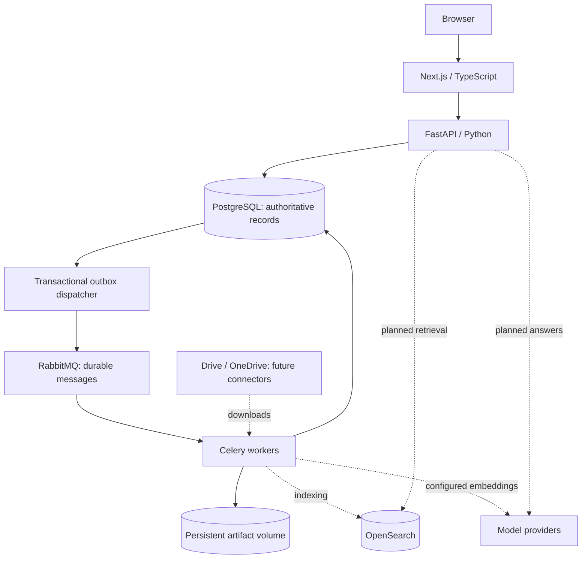

# Architecture overview

The application foundation and diagnostic job engine are implemented. The parser/indexing pipeline is implemented for authorized revisions. Live source
connectors and question answering remain planned.

| Component | Role |
|---|---|
| Next.js and TypeScript | Browser workspace, navigation and authenticated Operations status. |
| FastAPI and Pydantic | Validate requests, authenticate sessions and expose bounded APIs. |
| PostgreSQL | Authority for identity, permissions, jobs, attempts, outbox and active generations; document/revision records come with ingestion. |
| SQLAlchemy and Alembic | Typed database access and versioned schema migrations. |
| RabbitMQ | Transport persistent work messages. It holds delivery instructions, not the authoritative job history. |
| Celery workers | Separate background processes. They claim a database lease, execute an installed task, heartbeat and commit completion. |
| Outbox dispatcher | Sends committed jobs to RabbitMQ with confirms, retries failed publication and recovers expired work. |
| OpenSearch | Search engine for keyword and vector retrieval. Its future document index is a derived view, rebuildable from authoritative records/artifacts. The ingestion writer is implemented; product retrieval is not yet implemented. |
| Persistent artifacts | Files retained on a named volume: future downloaded originals and extracted processing outputs. Unlike temporary container files, the volume survives container recreation. |
| Docker Compose | Runs the local services and persistent volumes together. |
| Model provider adapters | Planned interfaces for embeddings and answer generation; no model credentials are needed for current diagnostics. |

For example, a future PDF ingestion request will commit a job, dispatch its ID,
and let a worker retain the original, extract/chunk text, embed it and prepare
search entries. A current-generation check must succeed before those entries
become visible. Today the same job/recovery machinery runs a bounded worker check.

Persistence is not backup: deleting a volume or losing its disk still loses its
contents. PostgreSQL, artifact storage and search storage have different
responsibilities; none grants a user access to another user's source.

See [runtime](README.md), [identity](IDENTITY.md), [jobs](JOBS.md), and the
[implementation plan](../../planning/IMPLEMENTATION_PLAN.md).
